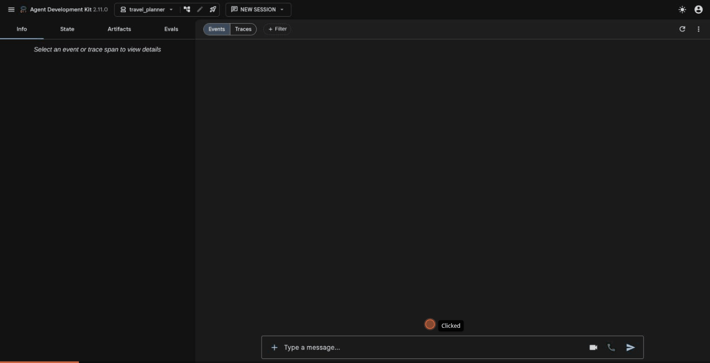

# Personal Travel Planner Agent (Google ADK)

A travel-planning agent built with the [Google Agent Development Kit (ADK)](https://google.github.io/adk-docs/).
Give it a request in plain English, for example:

> I want to visit Jaipur for 3 days with a budget of ₹15,000. I like history and local food.

It will:

1. **Understand the request**: destination, days, travellers, budget, interests (and ask if something essential is missing).
2. **Recommend places** ranked by how well they match your interests.
3. **Build a day-wise itinerary**, grouping nearby places on the same day and adding local food stops.
4. **Estimate the budget** (stay, food, local transport, entry fees and a 10% buffer) and check it against yours.
5. **Return a final plan**: trip summary → recommended places → day-wise itinerary → budget table → tips.



## How it works

```
travel_planner/
├── __init__.py
├── agent.py      # root_agent + tools + curated destination data
└── .env          # GOOGLE_API_KEY (not committed)
```

`root_agent` is a single ADK `Agent` (Gemini) with three Python function tools:

| Tool | Purpose |
|------|---------|
| `get_destination_info(city)` | Best time to visit, how to get around, local tip, all attractions, signature food |
| `recommend_places(city, interests)` | Ranks attractions by matching interest tags (history, food, beach, spiritual…) and returns food picks |
| `estimate_budget(city, days, travelers, total_budget_inr, planned_entry_fees_inr, comfort_level="auto")` | Calculates the cost breakdown, picks the comfort level that fits, and checks it against the budget |
| `get_weather_forecast(city, start_date, days)` | **Live** daily forecast from the free [Open-Meteo](https://open-meteo.com/) API (no key). Used when the user gives dates or travels within 2 weeks; the agent adapts the plan (indoor places on rainy/hot afternoons) and adds packing advice |

If a tool fails (e.g. the weather service is down), `on_tool_error_callback` turns the exception
into an error result, so the agent keeps going instead of the whole request failing.

The budget figures are computed by `estimate_budget`, not made up by the model. It also picks
the most comfortable level (premium → mid → budget) that fits the user's budget, so the model
doesn't have to.

Curated data covers **Jaipur, Udaipur, Goa, Varanasi, Delhi and Agra**. For any other city the
agent falls back to Gemini's general knowledge and labels the details as approximate.

The model is set by the `TRAVEL_AGENT_MODEL` environment variable (default `gemini-3.5-flash-lite`).
Requests that hit Gemini's temporary `503 high demand` errors are retried with exponential backoff.

## Setup

Requires Python 3.10+ and a Gemini API key from <https://aistudio.google.com/apikey>.

```bash
python -m venv .venv
source .venv/bin/activate
pip install -r requirements.txt

cat > travel_planner/.env <<'EOF'
GOOGLE_GENAI_USE_VERTEXAI=FALSE
GOOGLE_API_KEY=your-api-key-here
EOF
```

## Run

From the project root (the folder that contains `travel_planner/`):

```bash
# Browser chat UI (http://localhost:8000, pick "travel_planner")
adk web

# or in the terminal
adk run travel_planner
```

If port 8000 is in use: `adk web --port 8765`.

## Deliverables

| Item | Location |
|------|----------|
| Agent code | [`travel_planner/agent.py`](travel_planner/agent.py) |
| Dependencies | [`requirements.txt`](requirements.txt) |
| Screen recording (GIF) | [`screenshots/travel_planner_goa_demo.gif`](screenshots/travel_planner_goa_demo.gif) |
| Screenshots | [`screenshots/`](screenshots/): 8 screenshots of the ADK Web UI, including tool calls, itineraries and budget tables |
| Example conversations | [`examples/conversation_1_jaipur.md`](examples/conversation_1_jaipur.md): sample request + follow-up (2 people, lighter Day 3) |
| | [`examples/conversation_2_goa.md`](examples/conversation_2_goa.md): couple, mid-range over budget so the tool picks budget tier |
| | [`examples/conversation_3_udaipur.md`](examples/conversation_3_udaipur.md): incomplete request, agent states its assumptions |

## Notes

- Free-tier Gemini keys allow a small number of requests per model per day (20 at the time of
  writing), and each plan takes about 3 model calls. If you see `429 RESOURCE_EXHAUSTED`, wait for
  the quota to reset or set another model, e.g. `TRAVEL_AGENT_MODEL=gemini-3.8-flash adk web`.
- `adk web` stores sessions in `travel_planner/.adk/`; delete it to clear chat history.
- **Web search is not included.** ADK's built-in `google_search` tool needs a billing-enabled
  Gemini project; on the free tier every search returns `429 RESOURCE_EXHAUSTED`. To add it, enable
  billing and give the planner a search sub-agent (`Agent(tools=[google_search])`) wrapped in
  `AgentTool`, since Gemini can't mix built-in search with custom function tools in one request.
  Alternatively, wrap a search API such as Tavily in a normal function tool.
- The example conversations were recorded before the weather tool was added, so they don't use it.
